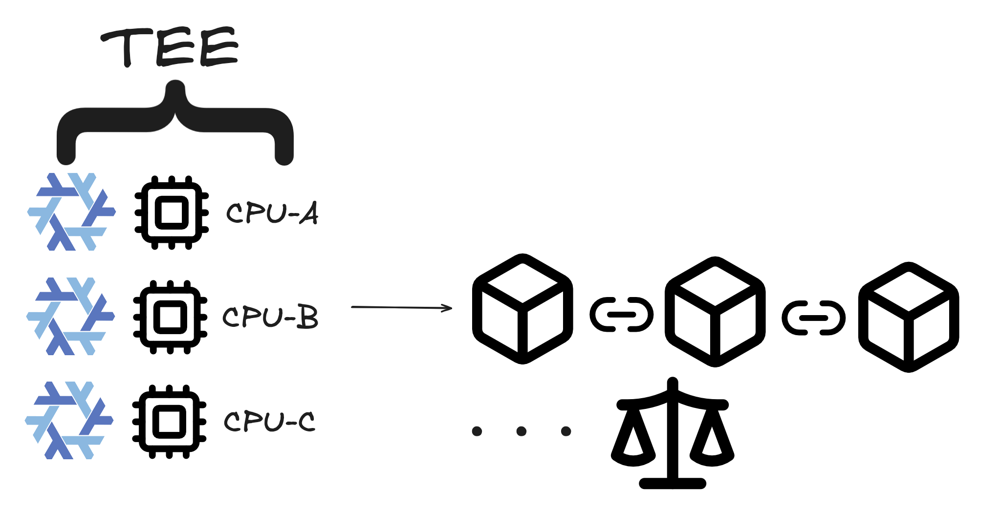
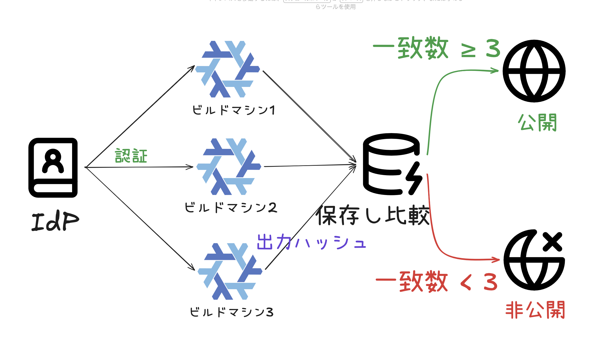
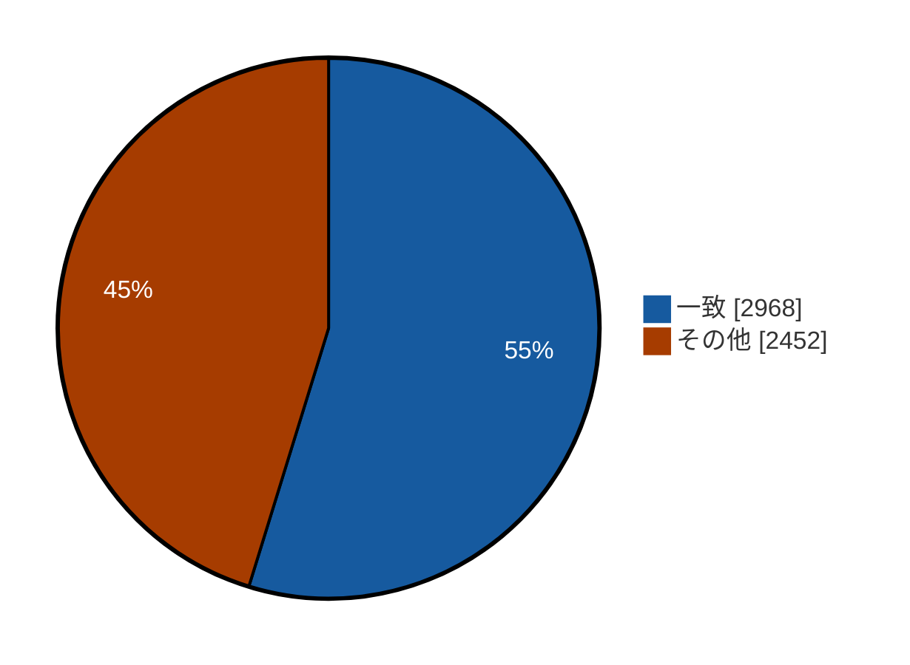
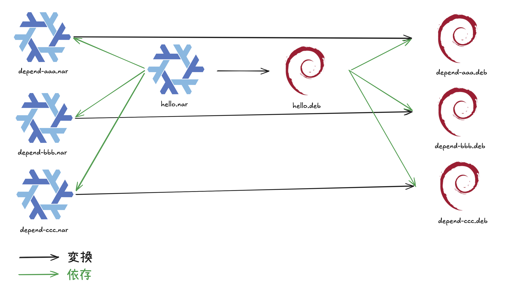

# sechack-4th

akazdayo

<!--
早めに文字サイズ変える
-->

---
src: ../../../shared/components/slidev/self-introduction.md
---

---
layout: statement
---

# 世界一かわいいNix。

<!--
ここ、文脈がなってない
-->

---

# 私が惹かれたNixさんの良いところ

1. ビルドが再現できる
2. 再現性から生まれる無限の面白さ

---
layout: statement
---

## 例えば、こんな世界観をNixが秘めてるとしたら？

- 時間を越える面白さ

<v-click>
例え、50年後にビルドをしても成功したら全く同じ結果が手に入る
</v-click>

- 環境、場所を越える面白さ

<v-click>
とは、例え違う環境でも、違う場所でも、
ビルドが成功すれば同じハッシュの成果物をビルドできる。
</v-click>

<!--
> 時間を越える面白さ

とは、外部ネットワークに依存したパッケージが
後から内容が変更されても、それに気づくことができる。
50年後にも動くよねっていう表現をスライドにも載せたいよね。

> 環境、場所を越える面白さ

とは、例え違う環境でも、違う場所でも、
ビルドが成功すれば同じハッシュの成果物をビルドできる。
-->

---
layout: statement
---

## そんな面白さを作れるツールがあるとしたら

## 世界はもっと良くなる

---
layout: statement
---

# つまり、私は世界で一番Nixの再現性が好き!

---
layout: statement
---

# だけど、

# そう簡単には行かないみたい...

---
layout: statement
---

## Nixに私の理想な再現性はあるけど無かった

---

## Nixにある現状の問題

Nixを利用するためには現実的にリモートキャッシュが必要不可欠。  
それは、Nixは<u>全てをビルドする代わりに再現性を手に入れた</u>からである。

<!--
Nix自体には再現性がある。そのための仕組みも面白い  
なのにも関わらず、Substituterの存在によってその再現性は失なわれてしまっている現状がある。  
Nixには、Fixed-Outputという素晴しい仕組みがあるのに、何故Substituterにはそれが適用されないのだ。  
現実的に、Content Addressedな世界を実現するのは難しいとしつつ、Substituterが何如なる状況でも正しいとされてしまう世界で本当に良いのか。
-->

---

## ビルドの大変さ

ビルド自体そこまで大変とは思わないかもしれないが、Nixにとってはワケが違うのである。

1. C言語のプログラムを記述した。
2. それをGCCでコンパイルした。
3. そのGCCをコンパイルするには？

このように、Nixでは全てのビルド依存をビルドする必要が発生してしまう。数時間~数十時間かかってしまうだろう。

<!--
数時間から数十時間のところに、前提を書く必要がありそう。(小さいもじでも)

下にビルド依存関係の木構造の図を載せると良さそう
-->

---

## そのためのSubstituter

NixにはSubstituterという仕組みが存在し、既にビルドした成果物をリモートキャッシュとして配布する仕組みがあるのである。  
これによって、ビルドするステップを大幅に減らすことが可能。

---
layout: statement
---

## でも、Substituterは本当に信頼できるの？

---

## 具体的な課題の定義

Nixの再現性は、Substituterによって失なわれる危険性があるが、それを解決するにはどうするか。  
しかしながら、それを解決する完璧な方法は今現状では見つかっていない。  
まずは、Substituterによって「Nixの再現性がなぜ脅かされるのか」について考える。

- Substituterが後から結果を差し変えても気付く方法はない
- Substituterのビルド結果の出自を検証できない
  - よって、依存関係を含めた正当性が保証されない
  - InputAddressedな世界においては、Substituter同士で結果が競合しうる

**Substituterの不正に対してあまりにも脆弱である**

<!--
ビルド結果が差し替えられる可能性についてもっと説明する。
極端なケースについて話してみると想像しやすいかも
例えば、コンパイラの汚染によって全てが崩れるよねみたいな話とかいいかも。

Substituterがどれだけ重要な役割を持っているのかを表現したい。

署名しか、信頼源が無いことを表現した方が良さそう。
-->

---

## あるべき世界

<!--Nixは非決定論的処理をビルドに含めない限りは、常に再現性を保てると言える状態であるべき**-->

**Nixは常に再現性のある状態であるべき!**
と私は考える。

<!--
ここ大事なので、もっとシンプルに詰まらずに説明できるようする。
文章をもっとシンプルに綺麗にまとめるべきかもー
-->

---

## それを解決するために考えたこと

> Substituterが後から結果を差し変えても気付く方法はない

Substituter自体のappend-onlyなrevisionを保持するべき

> Substituterのビルド結果の出自を検証できない

独立した監査, ビルドが複数必要

**これらを実装することが目標である**

---

## Nixだけではないかもしれない

> > Substituterのビルド結果の出自を検証できない

> 独立した監査, ビルドが複数必要

**これはNixに限った話ではない**

そもそも、バイナリ配布型のパッケージマネージャは脆弱かもしれない。  
例え、オープンソースであれど、配布されているバイナリがそのソースから作成されたことを保証する仕組みは存在しない。

---
layout: statement
---

# これを解決することが目標!

---

# SecHack期間中に試してみたこと

- ビルド成果物のハッシュを共有して合意形成を行う
  - インターネットでやりたかったが、何を持って一票として扱うかが難しく現在苦戦中
  - **IdPを信頼する場合は上手く行った**
- NixからDebianパッケージに変換するbundler
- Substituterを定期監査して、差し変えがあったときに気づけるログ

<!--
全体像があると良いかも。
それぞれの関係性についての図を書く
-->

---
layout: two-cols-header
---

# ビルド成果物のハッシュを共有して合意形成を行う

::left::

### インターネット上で行う

インターネット上で信憑性のあるビルド結果を暗号的に公開し、複数の暗号を元に合意形成を行う

#### 面白ポイント

- 誰でも参加できて、合意形成が行われる
- 信頼する対象が極限まで少なく面白い

 

#### 難しさ

- 一人が一人であることを証明することが難しい
- 本当にビルドを実行したことを証明することが難しい
- TEEを用いて、ビルドの証明を行おうと思ったが非常に難しいことが分かった(まだ試行錯誤中)

::right::

---
layout: two-cols-header
---

### イントラネット上で行う

::left::

#### 面白ポイント

- IdPを信頼するだけで良い
- コミュニティ内で互いに協力してSubstituterを構築できる
- ビルドフックでSubstituterにプッシュするだけで良い

これは難無く実装することができた。  
実際に2人で試してみたところ、キャッシュミスしたパッケージ5420件中2968件(1484組)が一致する結果となり、実際に有用であることが分かった。

::right::

<!--
キャッシュミスの説明が分かりにくいので考える

動いたものの画像が載せられると良い

Identityを一人一つに束縛する必要がある説明を入れたいかも

BitcoinならPoWだけどNixでやるとビルド&PoWはおかしいよね。みたいな
-->

---
layout: two-cols-header
---

# Nixから.debに変換する

::left::
**できること**: Nixから.deb packageへ変換

**目的**: Nixを用いた再現性の高いビルド結果をNix以外の世界へと広げたい

::right::

### 技術的アプローチ

Nixを用いてビルドしたあと、nix bundleコマンドでdebに変換する式を書いた。  
debの依存関係を適切に処理するため、/nix/store/ のパスごとにdebパッケージ化し、依存関係をDebian用に変換している。

#### わかったこと

- Nixでのビルドパッケージは、Nix向けに書いてあるので、パスなどをNixに合わせないといけない。
- よって、完全な変換は難しいが、バイナリを動かす程度までなら可能そう

<!--
動いている様子の画像を載せたい
-->

---

# Substituterを定期監査して、差し変えがあったときに気づけるログ

目的: Substituterが後からパッケージを置き換えることを防ぐ

得られること: SubstituterにFOD的アプローチを実装できる。

---

# これからやりたいこと

- ハッシュによるビルド結果の合意形成を引き続き検討する
- 配布履歴を追跡できる、Nixを使ったパッケージマネージャを考える
