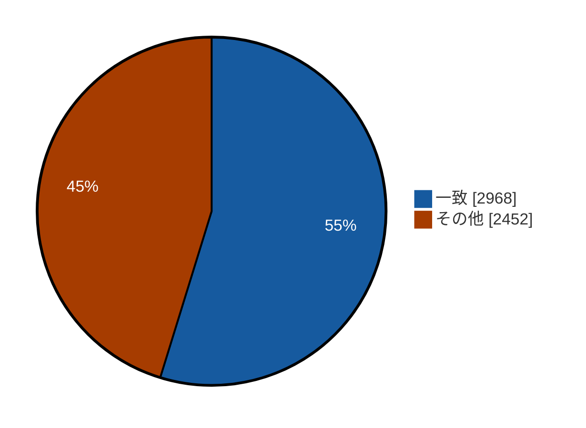
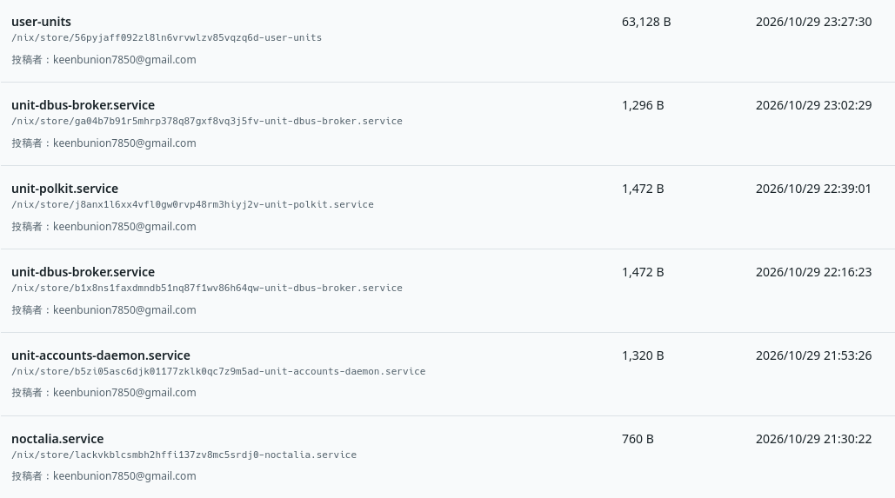
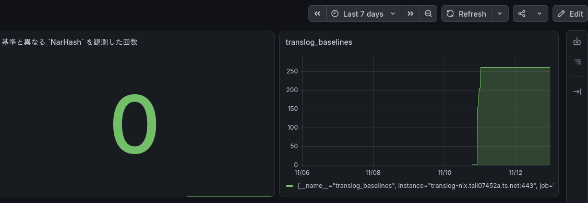

# sechack-4th

akazdayo

---
src: ../../../shared/components/slidev/self-introduction.md
---

---
layout: statement
---

# 私には、大好きなツールがあります。

---
layout: statement
---

# それが、Nixです。

---
layout: statement
---

# 私にとっては、世界一かわいいNix。

---
layout: statement
---

# 今日は、その好きなところを話します。

---

# 私が惹かれたNixさんの良いところ

1. ビルドが再現できる
2. 再現性から生まれる無限の面白さ

---

## 例えば、こんな世界観をNixが秘めてるとしたら？

- 時間を越える面白さ

<v-click>
例え、50年後にビルドをしても成功したら全く同じ結果が手に入る
</v-click>

- 環境、場所を越える面白さ

<v-click>

とは、例え違う環境でも、違う場所でも、
ビルドが成功すれば同じハッシュの成果物をビルドできる。

</v-click>

<!--
> 時間を越える面白さ

とは、外部ネットワークに依存したパッケージが
後から内容が変更されても、それに気づくことができる。

> 環境、場所を越える面白さ

とは、例え違う環境でも、違う場所でも、
ビルドが成功すれば同じハッシュの成果物をビルドできる。
-->

---
layout: statement
---

## そんな面白さを作れるツールがあるとしたら

## 世界はもっと良くなる

---
layout: statement
---

# つまり、私は世界で一番Nixの再現性が好き!

---
layout: statement
---

# だけど、

# そう簡単には行かないみたい...

---
layout: statement
---

## Nixに私の理想な再現性はあるけど無かった

---

## Nixにある現状の問題

Nixを利用するためには現実的にリモートキャッシュが必要不可欠。  
それは、Nixは<u>全てをビルドする代わりに再現性を手に入れた</u>からである。

<!--
Nix自体には再現性がある。そのための仕組みも面白い  
なのにも関わらず、Substituterの存在によってその再現性は失なわれてしまっている現状がある。  
Nixには、Fixed-Outputという素晴しい仕組みがあるのに、何故Substituterにはそれが適用されないのだ。  
現実的に、Content Addressedな世界を実現するのは難しいとしつつ、Substituterが何如なる状況でも正しいとされてしまう世界で本当に良いのか。
-->

---

## ビルドの大変さ

ビルド自体そこまで大変とは思わないかもしれないが、Nixにとってはワケが違うのである。
<v-clicks>
例えば、Hello Worldをコンパイルする。

- 直接的な依存: 4
- コンパイラなどを含む間接的な依存: <u class="color-red">960</u>

**すべてコンパイルするのは非現実的である**
</v-clicks>

---

## そのためのSubstituter

Substituterが代わりにキャッシュを返してくれる!  
よって、ローカルでビルドを行わずにも、Nixの再現性の恩恵を受けられる!

<!--
NixにはSubstituterという仕組みが存在し、既にビルドした成果物をリモートキャッシュとして配布する仕組みがあるのである。  
これによって、ビルドするステップを大幅に減らすことが可能。
-->

---
layout: statement
---

## でも、Substituterは本当に信頼できるの？

---

## 具体的な課題の定義

Nixの再現性は、Substituterによって失なわれる危険性が存在し、それは<u>**非常に大きな課題である。**</u>  
しかしながら、それを解決する完璧な方法は今現状では見つかっていない。

---

## 具体的な課題の定義

<u>なぜ、SubstituterによってNixの再現性が脅かされるのか</u>

- Substituterが 後から結果を差し替えても気付けない
- Substituterのビルド結果の出自を検証できない

---
layout: statement
---

## 例えば

---
layout: statement
---

# コンパイラのビルドが不正だったら？

---
layout: statement
---

# 同じパッケージを取得したのに、昨日と今日で中身が違ったら？

---
layout: statement
---

## Substituterは必要不可欠。

<h2 v-click class="color-red"><bold>でも、その不正にはあまりにも脆弱。</bold></h2>

---
layout: statement
---

## あるべき世界

<v-clicks>

Nixは常に再現性のある状態であるべき!  
と私は考える。

</v-clicks>

---

## それを解決するために考えたこと

<v-clicks>

> Substituterが後から結果を差し変えても気付く方法はない

Substituter自体のappend-onlyなrevisionを保持するべき

 

> Substituterのビルド結果の出自を検証できない

独立した監査, ビルドが複数必要

これらを実装することが目標である

</v-clicks>

---

## Nixだけではないかもしれない

> > Substituterのビルド結果の出自を検証できない

> 独立した監査, ビルドが複数必要

<v-clicks>

これはNixに限った話ではない

そもそも、バイナリ配布型のパッケージマネージャは脆弱かもしれない。  
例え、オープンソースであれど、配布されているバイナリがそのソースから作成されたことを保証する仕組みは存在しない。

</v-clicks>

---
layout: statement
---

# これを解決することが目標!

---

# SecHack期間中に試してみたこと

<v-clicks>

- ビルド成果物のハッシュを共有して対応するハッシュの合意形成を行う

- Substituterを定期監査して、差し変えがあったときに気づけるログ

- NixからDebianパッケージに変換するbundler

</v-clicks>

<!--
全体像があると良いかも。
それぞれの関係性についての図を書く
-->

---

# 合意形成を行う案は二つに分けてみた

- 誰でも参加できるネットワークでやる
- 限定された人のみ参加できるネットワークでやる

---
layout: two-cols-header
---

# インターネット上での合意形成

::left::

インターネット上で信憑性のあるビルド結果を暗号的に公開し、複数の暗号を元に合意形成を行う

#### 面白ポイント

- 誰でも参加できて、合意形成が行われる
- 信頼する対象が極限まで少なく面白い

::right::

---

## インターネット上で行う難しさ

- 一人で何票も投じられてしまう
- 本当にビルドを実行したことを証明することが難しい
- TEEを用いて、ビルドの証明を行おうと思ったが非常に難しいことが分かった(まだ試行錯誤中)

<!--
アイデンティティを用意するコストが低いため、悪意を持った人が100票作ることもでき、正しい合意形成が出来ない

例えば、BitcoinではPoWで参加者の影響力を制限する
↓
でも、ビルドに加えてPoWも行うのは負担が大きい
↓
そこで、ビルドの実行をTEEで証明できないか考えた
↓
TEEの技術難しくて今試行錯誤中...
-->

---
layout: two-cols-header
---

### イントラネット上で行う

::left::

#### 面白ポイント

- IdPを信頼するだけで良い
- コミュニティ内で互いに協力してSubstituterを構築できる
- ビルドフックでSubstituterにプッシュするだけで良い

::right::

---
layout: two-cols
---

## イントラネットでの   実験結果

ビルドフックとして実装し、実験するところまで進めることができた。  
NixOSでは日常からパッケージインストールでビルドを行うため、ビルドフックを追加した状態で生活してもらい、実験を行った。

::right::

記録されたビルド結果5420件中2968件(1484組)が一致する結果となり、有用である可能性を示すことができた。

---

# 登録されたビルド成果物

---
layout: two-cols-header
---

# Nixから.debに変換する

::left::
**できること**: Nixから.deb packageへ変換

**目的**: Nixを用いた再現性の高いビルド結果をNix以外の世界へと広げたい

::right::

---

# .debへの変換：技術的アプローチ

Nixを用いてビルドしたあと、nix bundleコマンドでdebに変換する式を書いた。  
debの依存関係を適切に処理するため、/nix/store/ のパスごとにdebパッケージ化し、依存関係をDebian用に変換している。

---

# .debへの変換でわかったこと

- Nixでのビルドパッケージは、Nix向けに書いてあるので、パスなどをNixに合わせないといけない。
- よって、完全な変換は難しいが、バイナリを動かす程度までなら可能そう

<!--
動いている様子の画像を載せたい。
図とかでも良いかもね
-->

---

# Substituterを定期監査する

<u>思想:</u>  
SubstituterにもNixと同じように  
羃等性のある制約を持つべき

<u>できること</u>  
登録済パッケージに定期的に問い合わせをし、TransparencyLogに記録する  
→ Substituterが内容を変更した時に気づける

---

# 軽く運用してみた

<!--
二日くらい適当に運用している限りは、今のところ0件
-->

---

# これからやりたいこと

- ハッシュによるビルド結果の合意形成を引き続き検討する
- 配布履歴を追跡できる、Nixを使ったパッケージマネージャを考える
